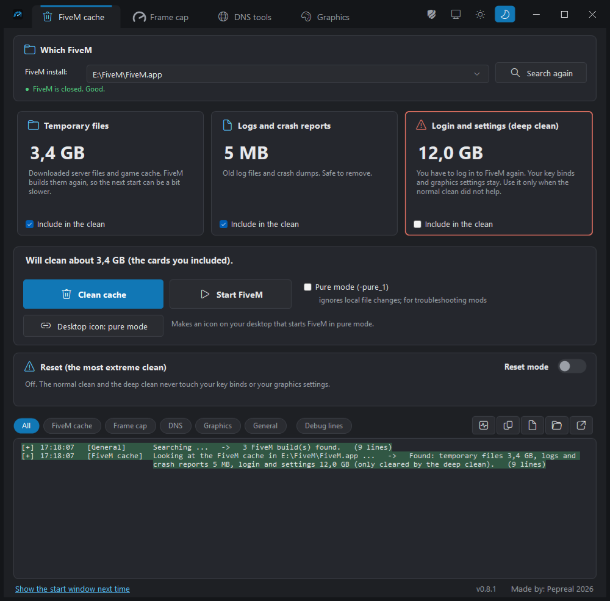
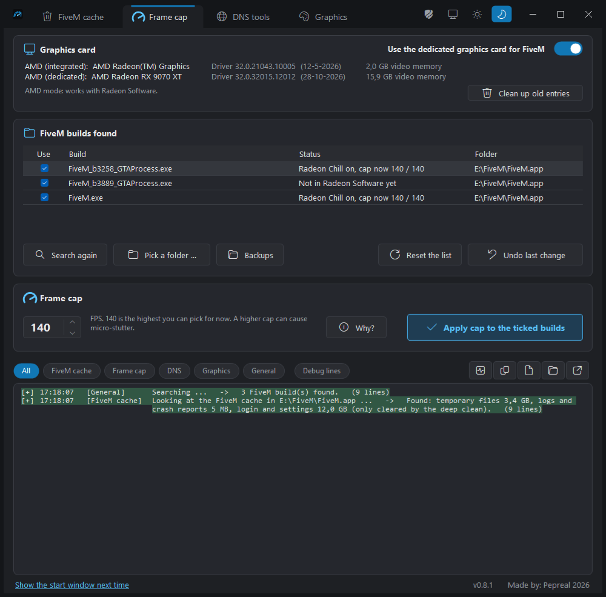
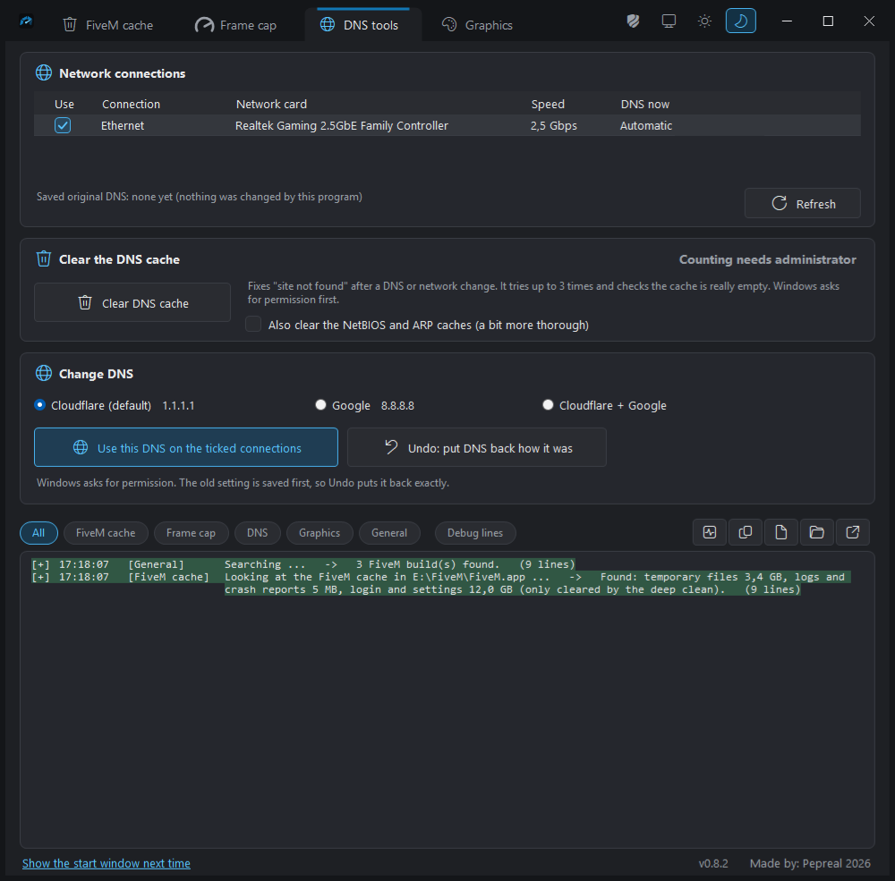
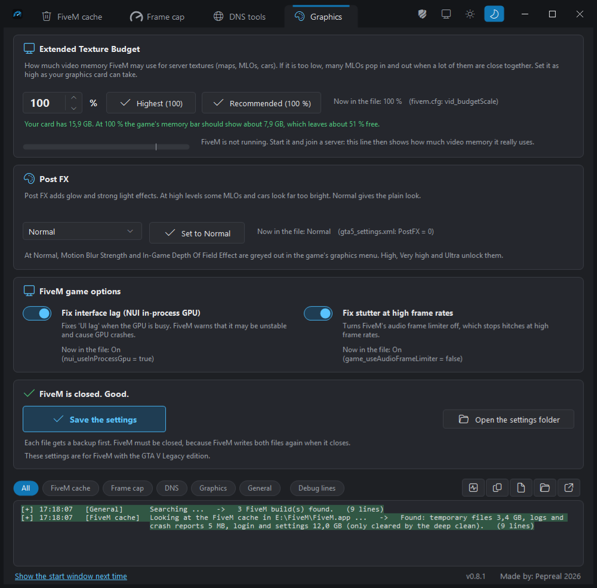

# FiveM Toolbox

A small Windows program for FiveM players. One exe, nothing to install.

Made by Pepreal with Claude AI.

## What it does

The program has four tabs.

### FiveM cache



Cleans the FiveM cache. There are three levels:

- **Normal clean:** temporary files, logs and crash reports.
- **Deep clean:** also the saved web data and logins (`nui-storage`) and the saved game files (`game-storage`). Your key binds and graphics settings are not touched.
- **Reset:** the most extreme clean. FiveM starts like a new install. It also removes your key binds and graphics settings, so it sits behind a "Reset mode" switch and a big warning window. A full copy of the settings folder is saved first. If the copy fails, nothing is deleted. The Rockstar Games folder (your GTA V save games) is never touched.

The program does not clean while FiveM is open. A button closes FiveM for you.

**Desktop icon: pure mode** makes an icon on your desktop that starts FiveM in pure mode (`-pure_1`: FiveM ignores local file changes, for troubleshooting mods).

### Frame cap



Sets a frame limit for every FiveM build (every `FiveM_b####_GTAProcess.exe`, and `FiveM.exe`). The box stops at 140 FPS. The GTA V engine was never made for very high frame rates, and players report micro-stutter above about 140 FPS.

- **NVIDIA:** through the driver's own profile database, the way NVIDIA Profile Inspector does it. The program reads the value back to check that the driver kept it.
- **AMD:** through Radeon Software's own profile file (Radeon Chill min and max FPS).
- **Undo last change** puts the old values back.
- On a PC with an integrated chip and a dedicated card, the program can also set the Windows graphics preference of FiveM to the dedicated card. A frame cap only works when FiveM runs on that card.
- **Clean up old entries** removes old driver profiles and Windows entries that this program left behind. It asks first.

### DNS tools



Clears the DNS cache (it checks the result and tries again), and changes DNS to Cloudflare, Google or both, with an Undo. These need administrator rights. Windows asks once.

### Graphics



Reads FiveM's settings files and changes one line at a time. FiveM must be closed, and a backup is made first.

- **Extended Texture Budget** (`vid_budgetScale` in `fivem.cfg`), with a "Highest" button and a "Recommended" button. The advice depends on the video memory of your card and is shown green, orange or red. It is an estimate.
- **Live meter:** how much video memory the FiveM game really uses on your dedicated card, read from Windows. Needs Windows 10 version 1709 or newer.
- **Post FX** (`gta5_settings.xml`): set it to Normal for MLOs and cars that look far too bright.
- **Two game options** from FiveM's own Settings menu: "Fix interface lag" (`nui_useInProcessGpu`) and "Fix stutter at high frame rates" (the Audio frame limiter off, `game_useAudioFrameLimiter`). FiveM itself warns that the first one may cause GPU crashes. The Graphics tab is for FiveM with the GTA V Legacy edition.

The window is in English, Dutch, German, French and Spanish. It follows the Windows language. To force a language, put a line like `language=nl` (or `de`, `fr`, `es`, `en`) in `settings.txt` in `%LOCALAPPDATA%\FiveMToolbox`.

## Download

Go to **Releases** and download `FiveMToolbox.exe`. Double-click it.

- Windows 10 or 11, 64 bit.
- Nothing to install. The .NET Framework that it needs is part of Windows.
- The text is sharp on screens with scaling (125 %, 150 %). If it looks wrong on your PC, start the program with `--no-dpi`.
- Windows may say "Windows protected your PC", because the file is not signed. Click "More info", then "Run anyway".
- If you do not want to trust a ready-made file, build it yourself (see below), or compare its SHA-256 with the one on the release page.

## Graphics cards

- **NVIDIA:** supported. No administrator rights were needed in the tests. If saving needs them, the program says so, and the shield button restarts it as administrator.
- **AMD:** supported. Radeon Software closes and opens again during a change. A build that Radeon Software does not know yet is added by the program itself (through AMD's own library, and it shows in Gaming > Games), copied from the profile of another build in Radeon Software that has Radeon Chill values. Undo takes it out again. If there is no profile to copy from, add one FiveM build in Radeon Software once (Gaming > Games) with Radeon Chill switched on.
- **Intel Arc (a dedicated Intel card):** not supported at the moment, because the author could not test it. An Intel chip in the processor is not a problem.

Developed and tested on Windows 11 with an AMD Radeon RX 9070 XT, an NVIDIA RTX 4060 laptop and an NVIDIA RTX 4080.

## Safety

- Every change makes a backup first. The "Backups" button opens the folder (`%LOCALAPPDATA%\FiveMToolbox\backup`).
- The program checks its own work after a change.
- It writes a log file (`FiveMToolbox-log.txt`) next to the exe, or in your local AppData folder when that folder is read-only. The "Report" button copies the whole log. The log has file paths and the name of your PC in it, so read it before you paste it in public.

## Build from source

The whole program is one C# file. It is written for the C# compiler that is built into Windows (C# 5), so there is nothing to install.

```
powershell -ExecutionPolicy Bypass -File source\build.ps1
```

The exe is made in `app\FiveMToolbox.exe`. Or double-click `source\build-and-run.bat`: it builds and starts the program. `-OutDir <folder>` builds somewhere else.

There are command line switches for diagnostics and self-tests (for example `--nv-probe <file>`, `--vram-probe <file>`, `--tab-order-test <file>`, `--dpi-test <file>`). Most only read. See the source.

## Problems

Open an issue and attach `FiveMToolbox-log.txt`. Say which graphics card you have.

## Not affiliated

This is not made by, and not endorsed by, Cfx.re (FiveM), Rockstar Games, NVIDIA or AMD. FiveM, GTA V, NVIDIA, GeForce, AMD and Radeon are trademarks of their owners.

The program changes settings of your graphics driver, of Windows and of FiveM. It makes a backup first, but you use it at your own risk (see the license).

## License

MIT. See [LICENSE](LICENSE). Keep the copyright line when you use the code.
